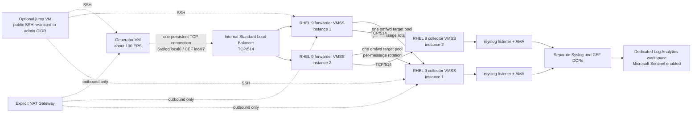

# rsyslog load balancing for Azure Monitor Agent ingestion

A reproducible Azure lab for measuring per-message distribution from one persistent TCP syslog connection through an rsyslog `omfwd` target pool to two Azure Monitor Agent (AMA) collectors.

## Architecture



Azure Load Balancer hashes connections, not individual syslog messages. A long-lived generator connection normally stays on one healthy forwarder. Each forwarder has one TCP `omfwd` action with a two-address target pool, so it can distribute messages to both collectors. There is no preferred forwarder. A health probe does not move an established connection; generator reconnection is needed after an ingress forwarder failure. Neither immediate nor lossless failover is promised.

The collector addresses are discovered once when each forwarder boots, using its managed identity to read VM scale-set NICs. If a collector is replaced and its address changes, rerun the forwarder setup script on both forwarders. No membership reconciler or autoscaler is included.

The forwarder scale-set identity receives the built-in Reader role only on the dedicated lab resource group for this lookup. A collector NIC-level NSG allows TCP/514 from the logging subnet and denies other VNet sources, preventing the generator from bypassing the Load Balancer and contacting collectors directly.

## Included

- `infra/`: AzureRM Terraform for the VNet/subnets, NSGs, NAT Gateway, internal Standard Load Balancer, two fixed-size RHEL 9 VM scale sets, two separate DCRs, AMA extension, Sentinel workspace onboarding, dedicated Log Analytics workspace, generator VM, and optional jump VM.
- The current Sentinel connector instructions require the Syslog and Common Event Format solutions from Content hub if they are not already installed. Terraform enables Sentinel and creates the AMA rules/associations but does not install Content hub packages; install only those two solutions from the portal when needed. No unrelated solutions or analytics rules are included.
- `infra/scripts/configure-rsyslog-target-pool.sh`: standalone, rerunnable target-pool configuration for RHEL 9 and Ubuntu 24.04. It validates the destination count and names, writes only its own file, checks the full rsyslog configuration before restart, and restores the previous generated file if validation or activation fails.
- Collector bootstrap uses Microsoft's documented [Forwarder_AMA_installer.py](https://raw.githubusercontent.com/Azure/Azure-Sentinel/master/DataConnectors/Syslog/Forwarder_AMA_installer.py) to configure the rsyslog listener, verifies its pinned SHA-256 before execution, and then installs a small local capture rule for routing measurements. If Microsoft updates the script, bootstrap fails until its new contents are reviewed and the checksum is deliberately updated. AMA itself is installed by the VM scale-set extension and configured with Terraform DCR associations.
- `scripts/generate_events.py`: persistent-TCP generator with run ID, sequence, timestamp, Syslog `local6`, and CEF `local7`; records one sender-side JSON Lines entry per attempted event and reports attempted/send-completed counts per facility.
- `scripts/summarize_capture.py`: compares generator outcomes with per-forwarder ingress and per-collector receipt logs, including facility-level counts, sequence gaps, duplicates, and collector distribution.
- `queries/validation.kql` and `queries/duplicate-sequences.kql`: Log Analytics queries for eventual Syslog and CEF ingestion and duplicate-sequence checks.

## Important behavior and limits

- The target pool is TCP-only. Upstream rsyslog documents round-robin selection among available targets for TCP pools; UDP would send only to the first target. See the [omfwd target-pool documentation](https://docs.rsyslog.com/doc/configuration/modules/omfwd/parameters/basic.html).
- The collector capture log is rotated at 128 MiB, with four retained rotations, so long test runs do not grow that measurement file without bound.
- Each rsyslog forwarder also captures matching `local6`/`local7` events on ingress to `/var/log/ama-lab/forwarder-received.log`, with the same bounded rotation policy. This is an observation point before `omfwd`; it does not prove the forwarding action or downstream collector accepted that event. The local file write adds I/O overhead, so use this lab to measure routing distribution rather than as a zero-overhead throughput benchmark.
- The forwarding queue is one-worker, bounded to a 1 GiB disk limit, retries indefinitely, and does not silently discard by severity. If it fills, input can back up; the sender may still drop data. Queue files are not replicated and do not make all in-memory events crash-durable.
- The primary distribution evidence is the generator attempt/send outcome, each forwarder's local ingress capture, and each collector's local receipt capture. A successful TCP `sendall` only indicates the local socket accepted the write; it does not prove the forwarder processed the complete event.
- The two DCRs keep facilities separate: `local6` to `Syslog`, and `local7` to `CommonSecurityLog`. Both collect all listed severities. `Computer` is not used to infer which collector received an event; routing balance is measured from the collector-local capture files.
- The configuration is plaintext TCP. TLS and certificate provisioning are deferred. No direct forwarding to AMA's internal port is configured.
- There is no autoscaling, collector discovery service, coordinated scale-in, active/passive forwarder clustering, separate queue disk, or multi-region design.
- The Log Analytics workspace uses pay-as-you-go (`PerGB2018`) and does not set a daily cap or retention override. Confirm actual retention, Sentinel billing, and ingestion charges in the subscription before use.
- RHEL Marketplace image, VM sizes, zone support, disk compatibility, regional quota, DCR/VMSS association behavior, and package target-pool support must be checked before deployment. They have **not** been validated in Azure. The default zone list is empty; populate `availability_zones` only after confirming the selected SKUs and region support the zones.
- The optional jump host is disabled by default. If enabled, `admin_cidr` is required. Do not use `0.0.0.0/0`.

## Prerequisites

- Terraform 1.5 or later and an AzureRM provider 4.x-compatible installation.
- Azure CLI authentication for Terraform (`az login` and `az account set --subscription ...`) or another supported AzureRM authentication method.
- A subscription ID and an SSH **public** key. Never put a private key in this repository or a `.tfvars` file. Python 3.9+ is needed to run the local generator tests and capture summary utility.
- Before planning deployment, check image/SKU availability and quota in `spaincentral`. For example, inspect `Standard_D2s_v5` and `Standard_B2s` availability, the configured Marketplace image offers/SKUs, 64-GiB and 32-GiB Standard SSD support, and the desired availability zones.

## Configure and validate locally

From `infra/`:

```text
copy lab.tfvars.example lab.tfvars
```

Edit `lab.tfvars` with the subscription ID and SSH public key. The optional jump host requires setting both `enable_jump_host = true` and a real administrator public IPv4 CIDR.

Then run:

```text
terraform fmt -recursive
terraform init -backend=false
terraform validate
```

These commands format and validate configuration without creating Azure resources. This repository has no remote Terraform backend; keep local state private and backed up. Do not commit state or populated `.tfvars` files.

To target a specific subscription in PowerShell, use that subscription ID both for Azure CLI context and Terraform's explicit provider variable:

```powershell
$subscriptionId = "<SUBSCRIPTION_ID>"
az login
az account set --subscription $subscriptionId
terraform plan -var-file="lab.tfvars" "-var=subscription_id=$subscriptionId" -out="lab.tfplan"
```

Review the saved plan before applying it with `terraform apply "lab.tfplan"`. Applying creates billable Azure resources. `lab.tfvars` must contain the SSH public key; never provide a private key.

## Lab test sequence

The generator defaults to 100 aggregate EPS for ten minutes. With `--format both`, it alternates Syslog and CEF; evaluate their combined counts as well as each stream. Run from the generator VM, using the internal LB address from `terraform output -raw syslog_load_balancer_private_ip`:

```text
sudo -u labadmin python3 /usr/local/bin/generate-events.py \
  --target 10.80.2.10 --rate 100 --duration 600 --format both
```

The script prints the generated run ID and sender log path. A custom run ID can be supplied with `--run-id`.

1. **Healthy distribution:** run the generator against two healthy collectors. Collect `/var/log/ama-lab/forwarder-received.log` and rotated files from each forwarder, plus `/var/log/ama-lab/received.log` and rotated files from each collector. Compare the generator, forwarder-ingress, and collector-receipt counts by facility and sequence. The summary utility reports each collector's combined and per-facility share plus out-of-order transitions. The expected collector split is approximately 50/50 for each facility; no exact balance tolerance was approved.
2. **One collector unavailable:** stop one collector, send traffic, then restore it. Measure loss, duplicates, recovery, and the split at each collector. The surviving target should remain available to the forwarding pool.
3. **Both collectors unavailable:** stop both for ten minutes at 100 EPS (about 60,000 attempted events), inspect the forwarding queue and sender outcomes, restore the collectors, and measure backlog drain and recovery. A 1-GiB queue is not a guarantee for every event size or outage.
4. **Ingress forwarder failure:** terminate or stop the forwarder receiving the test connection. Measure interruption and event outcomes while the generator reconnects through the internal Load Balancer. The failed TCP flow does not migrate automatically.
5. Use `scripts/summarize_capture.py --run-id <id> --generator-log <generator.jsonl> --forwarder-log <forwarder1.log> --forwarder-log <forwarder2.log> <collector1.log> <collector2.log>` to compare the generator with every forwarder ingress and collector receipt. Treat generator send completion as sender-side evidence only; collector-local captures are the evidence for the distribution target.
6. Log Analytics queries are optional downstream validation, not the acceptance criterion for the distribution experiment. Use `queries/validation.kql` or `queries/duplicate-sequences.kql` only when you also want to investigate AMA/DCR/workspace ingestion.

Collectors have no public IP. Retrieve capture logs through the optional jump host or Azure VM Run Command. Do not open collector SSH to the internet.

## Cost and cleanup

The lab includes five Standard D2s_v5 machines (one generator, two forwarders, two collectors) plus an optional B2s jump VM, RHEL PAYG licensing, Standard SSD OS disks, a NAT Gateway and public IP, a Standard Load Balancer, and Log Analytics/Sentinel ingestion. Actual cost varies by region, runtime, retention, and ingested volume; stop or destroy the lab when tests are complete.

To remove a deployment, review the targeted workspace/state first, then run `terraform destroy -var-file=lab.tfvars` from `infra/`. This removes the lab resource group resources and retained Log Analytics data.

## References

- [Ingest Syslog and CEF messages to Sentinel using AMA](https://learn.microsoft.com/azure/sentinel/connect-cef-syslog-ama)
- [Syslog and CEF AMA connector overview](https://learn.microsoft.com/azure/sentinel/cef-syslog-ama-overview)
- [Collect Syslog events with Azure Monitor Agent](https://learn.microsoft.com/azure/azure-monitor/vm/data-collection-syslog)
- [Rsyslog omfwd target pools](https://docs.rsyslog.com/doc/configuration/modules/omfwd/parameters/basic.html)
